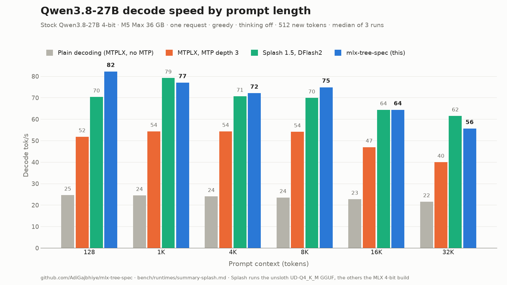
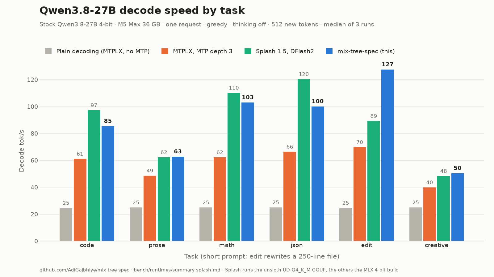

# mlx-tree-spec

Tree-speculative decoding with continuous batching for **Qwen3.8-27B on Apple Silicon**, as an
OpenAI-compatible server. It builds on [MTPLX](https://github.com/youssofal/mtplx)'s runtime and
kernels: the model's own multi-token-prediction (MTP) head drafts a small **tree** of candidate
continuations instead of one chain, and the target verifies all branches in one pass.

On an M5 Max, for one request, this decodes the 27B model **about 1.4x faster than MTPLX's own
MTP decoding** in the same benchmark harness (1.25–1.86x across contexts and tasks). It is
2.6–3.3x faster than plain decoding, and still does **56 tok/s at 32K context**. With **4 requests
at once** it does **128 tok/s total**.

> Status: research code that has run a few hundred agentic-coding sessions. Measured on one
> machine (M5 Max, 36 GB). Expect rough edges.

## Results

**Against MTPLX's MTP decoding.** These runs use the runtime harness in
[bench/runtimes](bench/runtimes): greedy decoding, thinking off, 512 new tokens, a unique nonce in
every prompt so no server can reuse a cached prefix, and one request at a time. The model is
stock Qwen3.8-27B 4-bit (the default download). MTPLX ran MTP at depth 3. Decode tok/s:

| context | 128 | 1K | 4K | 8K | 16K | 32K |
|---|---:|---:|---:|---:|---:|---:|
| plain decoding (MTPLX, no MTP) | 24.6 | 24.5 | 24.0 | 23.5 | 22.7 | 21.6 |
| MTPLX, MTP chain | 51.8 | 54.4 | 54.3 | 54.1 | 47.0 | 40.0 |
| this server | **76.6** | **76.2** | **71.0** | **76.3** | **66.1** | **56.0** |

| task (S2) | code | prose | math | json | edit | creative |
|---|---:|---:|---:|---:|---:|---:|
| MTPLX, MTP chain | 61.0 | 48.5 | 62.2 | 66.2 | 69.7 | 39.8 |
| this server | **87.2** | **62.8** | **100.8** | **102.2** | **126.5** | **51.3** |

Swift 1.5 (a Qwen3.8-27B fine-tune) gives the same picture: 1.31–1.41x over MTPLX's MTP across
contexts.

The one exception is MTPLX's "context copy" mode, which drafts by copying spans straight out of
the prompt. On a task whose answer is mostly the prompt's own file, it reaches 158 tok/s against
this server's 129. Time to first token is shorter than with MTPLX's MTP at every context:
17–21% at 128 tokens, 10% at 1K and 2–5% from 4K up (e.g. 48.0 vs 48.8 s at 32K on the stock
model). Long prompts run a prefill kernel that reads the packed 4-bit weights directly. The
server's first start takes ~40 s, because it measures its cost curves first; later starts reuse
the saved curves and take ~7 s, against MTPLX's ~10 s.

All tables are in [bench/runtimes/summary-tree.md](bench/runtimes/summary-tree.md). The MTPLX
rows were measured two days before the tree rows.

**Against Splash.** [Splash](https://github.com/incoai/splash) 1.5.0 runs the unsloth UD-Q4_K_M
GGUF of the same model with its trained DFlash2 block drafter, its own Metal kernels and a
Neural Engine split for prefill. Same harness, same night, 10 minutes idle before each server
(decode tok/s; TTFT in seconds):

| context | 128 | 1K | 4K | 8K | 16K | 32K |
|---|---:|---:|---:|---:|---:|---:|
| Splash, decode | 70.4 | **79.2** | 70.7 | 69.9 | 64.4 | **61.5** |
| this server, decode | **82.2** | 77.0 | **72.1** | **74.9** | 64.3 | 55.6 |
| Splash, TTFT | 0.34 | **1.27** | **4.32** | **8.59** | **17.88** | **39.39** |
| this server, TTFT | 0.34 | 1.41 | 5.26 | 10.66 | 22.35 | 48.52 |

| task (S2) | code | prose | math | json | edit | creative |
|---|---:|---:|---:|---:|---:|---:|
| Splash | **97.1** | 62.2 | **110.1** | **120.2** | 89.1 | 48.2 |
| this server | 85.3 | 62.7 | 103.0 | 100.0 | **127.5** | 50.3 |

Decode is about even overall. Splash's drafter accepts more tokens per pass on code, math and
JSON (5.2 vs 4.7 on code). The tree wins on edits (8.0 vs 4.8 tokens per pass), where long runs of
copied text suit it, and at short context. Splash reaches the first token about 20% sooner from
4K up, mostly from the Neural Engine prefill: with `--disable-ane` its 32K TTFT is 44.7 s. Splash
peaks at about 25.7 GB here, against 24 GB for this server with the bf16 KV cache these rows used
and 23 GB with the 8-bit default, which runs within noise of them. Splash's README quick-start settings and
the settings of its llama.cpp comparison (`--kv-format bf16 --disable-ane`) give the same decode
picture; all three Splash configs are in
[bench/runtimes/summary-splash.md](bench/runtimes/summary-splash.md).




**Long-context scenarios.** One request, greedy, tok/s, using the best tree shape for each
scenario:

| scenario | plain decoding | MTP chain | MTP tree | MTP tree, Swift 1.5 |
|---|---:|---:|---:|---:|
| summarize a codebase (27.9K-token prompt) | 21.2 | 54.8 | **56.9** | 60.9 |
| summarize a manual (27.9K-token prompt) | 21.2 | 61.5 | **64.1** | 63.0 |
| write a module (0.2K → 8.4K tokens) | 23.7 | 96.2 | **99.0** | 102.1 |
| write tests (15.1K → 19.2K tokens) | 22.6 | 88.4 | **92.3** | 111.9 |

"MTP chain" is this repo's adaptive single-chain drafter running on the same kernels, so the gap
between it and the tree is what the tree itself adds. Most of the gain over plain decoding comes
from what the two share: MTP drafting and kernels tuned for the verify pass. Runs vary by about
±3%. On "write tests", the stock model has fewer drafted tokens accepted per step than Swift 1.5
(about 5.9 against 7.5), which is why it's slower there. Raw results are in
[results/scenarios](results/scenarios).

**Batching** (decode only, greedy): 1 request 59–85 tok/s; 2 together 92, 3: 108, 4: 128 tok/s
total. Requests share every matmul, norm and MLP and the draft head; only the linear-attention
recurrence and attention run per request.

**End to end**, a private agentic coding eval (10 tasks × 3 trials, prompts up to 8.7K tokens,
prefill included; not part of this repo):

| setup | wall time | passed |
|---|---:|---:|
| MTPLX server (MTP chain), sequential | 62.4 min | 29/30 |
| this server, sequential | 50.6 min | 30/30 |
| this server, 4 sessions in parallel | **29.2 min** | 29/30 |

## How it works

- **Tree drafting.** At every depth the MTP head proposes its top tokens; confident stretches stay
  a chain, and the tree widens only where the head is unsure. Branches are drafted as one batch
  in the shared MTP cache with an ancestor mask, with no per-branch copy of the history.
- **Verifying a tree on a hybrid model.** Qwen3.8 has three Gated-DeltaNet (linear attention)
  layers per full-attention layer. Their recurrent state can't take a tree attention mask, so
  each verify pass records the recurrence inputs per token. After the accepted path is chosen,
  only that recurrence is replayed for the accepted tokens, and the KV caches are trimmed. The
  weights are not run again.
- **Cost-aware tree shape.** At startup the server measures how much a verify pass costs per node,
  at short and long context. The tree is sized to maximise expected accepted tokens per
  millisecond, not per pass.
- **Kernels.** Packed 4-bit matmuls tuned for the 8–16-row verify passes. A tree-mask variant of
  MTPLX's flash-decoding kernel for long context. Fused GatedDeltaNet and norm ops.
- **Continuous batching.** Up to `--max-batch` requests decode together. Each step drafts all of
  them at once and verifies every tree in one target pass.
- **Prompt-prefix reuse.** Linear-attention state can't be trimmed, so the server keeps snapshots
  at the user-turn boundary and at prefixes shared with recent prompts, and resumes from the
  longest match.
- **Target-exact acceptance.** A drafted token is kept only if it is the token the target itself
  picks at that position (its argmax, or its sample at `temperature > 0`). The draft head changes
  speed, not what gets generated.

The development log with every measurement, including what didn't help, is in
[docs/devlog.md](docs/devlog.md).

## Requirements

- **Apple M5-family GPU** (the packed matmuls and flash kernels use the M5's GPU neural
  accelerators) and macOS 26.2 or later. Tested only on an M5 Max with 36 GB. On M1–M4 the
  server and benchmark exit at startup with a message saying so; there is no fallback yet.
- About 20 GB of free unified memory for the 4-bit 27B model plus KV cache.
- Python 3.11+.

## Quickstart

```bash
git clone https://github.com/AdiGajbhiye/mlx-tree-spec && cd mlx-tree-spec
uv venv && uv pip install -e .
.venv/bin/mlx-tree-spec-server --port 8090
```

On first run it downloads [`Youssofal/Qwen3.8-27B-MTPLX-Bare-Speed`](https://huggingface.co/Youssofal/Qwen3.8-27B-MTPLX-Bare-Speed)
(Qwen3.8-27B in 4-bit with its MTP head, Apache-2.0). The first start measures cost curves for
about 35 seconds and saves them to `~/.cache/mlx-tree-spec/cost-curves.json`; later starts with
the same model, code, library versions, GPU, macOS and KV setting load them and are ready in
~7 s (`--remeasure-curves` measures again, `--no-curve-cache` never saves). `--model` takes any local MTPLX-compatible checkpoint or Hugging Face repo id.

```bash
curl -s localhost:8090/v1/chat/completions -H 'content-type: application/json' \
  -d '{"messages":[{"role":"user","content":"Write a haiku about caches."}],
       "max_tokens":200, "chat_template_kwargs":{"enable_thinking":false}}'
```

The server answers `POST /v1/chat/completions`, `GET /v1/models` and `GET /health`. Thinking is on
by default (the model's chat template). The reasoning comes back in `message.reasoning_content`,
and `--default-effort` sets `reasoning_effort` for requests that send none. `"stream": true` sends
server-sent events with one chunk per decode step, i.e. every token accepted in that step. The
reasoning arrives as `delta.reasoning_content`, and `stream_options.include_usage` adds a final
usage chunk. For 10 minutes after each request, the idle server runs a tiny GPU kernel every
second, so macOS keeps the weights resident and the next prefill doesn't pay ~0.2 s to restore
them; `--keepalive-window 0` turns this off. By default the attention KV cache switches to 8
bits once a request passes 8K cached tokens: about 1 GB less per request at 32K, with speed
within run-to-run noise of the bf16 cache, but the text is not bit-exact against it.
`--no-kv8` keeps the bf16 cache. `--help` lists the options.

Run the tests (the lossless check loads the model):

```bash
uv pip install -e ".[dev]"
MLX_TREE_SPEC_MODEL=Youssofal/Qwen3.8-27B-MTPLX-Bare-Speed .venv/bin/pytest
```

## Limitations

- Only the Qwen3.8-27B architecture (hybrid GatedDeltaNet with an MTP head) loaded through MTPLX.
- **Greedy output is not token-for-token identical to plain decoding.** Verify passes run 8–16
  rows through different kernels than one-token decoding, so bf16 rounding flips near-ties and
  the texts drift apart. In the saved benchmark runs half or more of the outputs diverge, some
  within the first 20 tokens. `tests/test_lossless.py` re-scores the output in one teacher-forced pass and
  checks that every emitted token is the target's own top choice, up to such near-ties. Task
  quality held in the eval above (30/30 vs the MTPLX baseline's 29/30).
- Prefill is within 1–2% of stock MLX's kernels in-process (and 2–5% faster than MTPLX's MTP
  server from 4K tokens up), but Splash's Neural Engine prefill reaches the first token about
  20% sooner from 4K up. The first start takes ~40 s because the server measures its cost
  curves; any code or library change measures them again.
- Greedy decoding at around 9K context isn't exactly repeatable from run to run, even with
  plain decoding; the cause isn't found yet.

## Repository layout

```
src/mlx_tree_spec/   server, decoder (tree_spec, tree_verify) and Metal kernels
tests/               unit tests; lossless check against plain greedy decoding
bench/prompts/       long-context benchmark scenarios
bench/runtimes/      the comparison harness (this server, llama.cpp, MTPLX, mlx-lm, DSpark) and its results
experiments/         one-off probes kept for reference (rank probe, draft vocab builder, ...)
results/             raw JSON behind the numbers above
docs/devlog.md       development log
```

Benchmark the decoding modes against plain greedy decoding on your own machine:

```bash
.venv/bin/python -m mlx_tree_spec.tree_spec --packed --draft-vocab general \
  --config fork:15,2,4,4 --prompt-file "bench/prompts/scenarios/3_write_module@8192.txt"
```

## Credits

Powered by [MTPLX](https://github.com/youssofal/mtplx) by Youssof Altoukhi. Built on
[MLX](https://github.com/ml-explore/mlx) and [mlx-lm](https://github.com/ml-explore/mlx-lm), with a
matmul kernel adapted from [dflash-mlx](https://github.com/bstnxbt/dflash-mlx). See
[NOTICE](NOTICE).

## License

Apache-2.0
